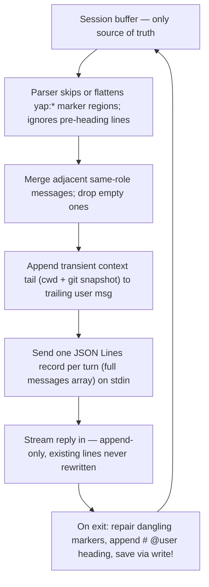
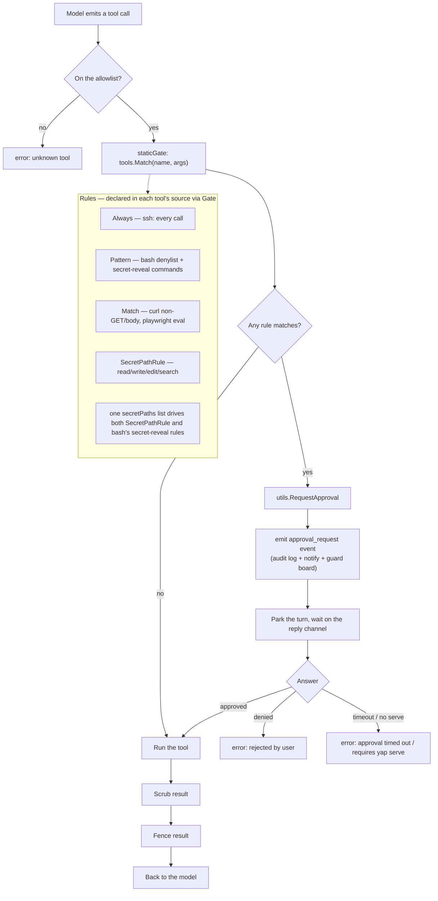
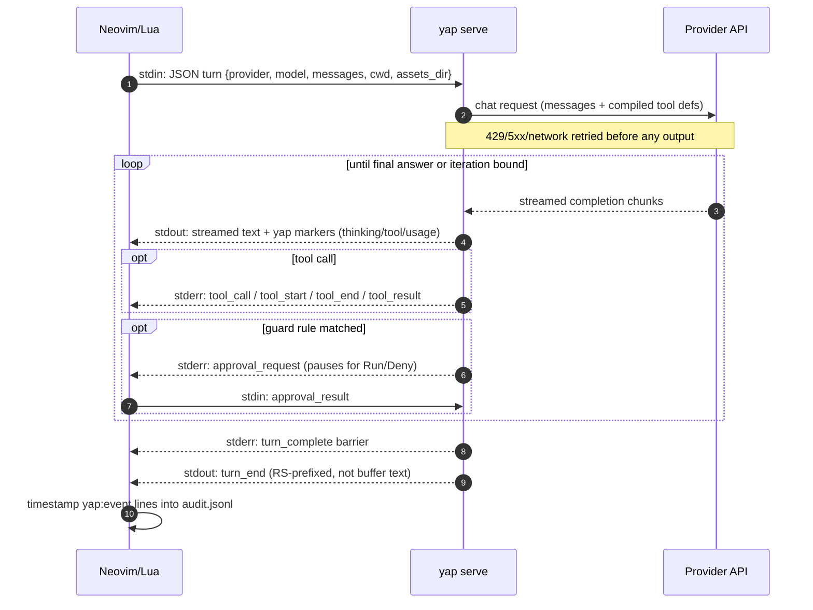

# Contributing to Yap

## Contributor policy

No large refactors. Changes are kept narrowly scoped and local, so each one
is reviewable against the numbered rules below without sprawling across
modules. When a change would touch many areas, restructure code, or rework
behavior beyond the task at hand, do not edit this checkout in place: fork
the project first (copy it to a separate directory) and make the change
there, with permission of user. This applies to **AI agents**.

## Working with the rules

The rules are the design contract, identified by stable `R-...` slugs (not
ordinal numbers), so they can move between sections and new ones can be added
without renumbering anything. Code, tests, and discussions refer to them by
slug. For a behavior change, find the relevant rule, update it with the
implementation, and add or adjust the corresponding tests. Preserve the reason
for the rule, not just the current mechanics.

## Running the tests

Yap requires Neovim 0.11 or newer (`vim.snippet.expand`, `vim.lsp.get_clients`).
The flake's devShell uses nixpkgs' Neovim (0.12, which satisfies the floor)
together with everything else the suite needs: Go, a python3 with `msgpack`,
and mini.nvim. That is the fast path:

```sh
nix develop                         # builds Neovim and the agent
nix develop --command tests/run.sh  # Go tests, fold-UI test, Lua suite
```

`tests/run.sh` also works outside the devShell — it builds the agent itself
and resolves what the ambient environment lacks from nixpkgs — but it then
runs whatever `nvim` is on `PATH`, so that one must be 0.11+ as well. A full
run takes about a minute; a subset is much faster:

```sh
CGO_ENABLED=0 go test ./...          # Go only, no nix and no Neovim needed
YAP_TEST_FILTER=winbar tests/run.sh  # one Lua case (substring of its name)
```

The tests spawn `./yap`, a symlink to the agent built by `run.sh`, so build
once after changing Go code. `nix develop` does that for you, and exports
`YAP_MINI_NVIM`, which saves `run.sh` a nixpkgs lookup.

The harness is [mini.test]:

- `tests/run.sh` — the entry point: Go tests, the attached-UI fold test, then
  the Lua suite.
- `tests/minitest.lua` — mini.test config; fails fast on the first failure.
- `tests/suite.lua` — one case per `tests/yap_<name>_test.lua` script. Add a
  case by adding its `{ name, port, mock }` row; nothing needs renumbering.
- `tests/yap_fold_ui_test.py` — drives an attached Neovim over msgpack RPC;
  runs on its own before the Lua batch.

Each case runs its script in a fresh child Neovim with its own `$HOME`,
`$XDG_CONFIG_HOME` and `$XDG_CACHE_HOME`, so session files, audit logs and the
mock provider config cannot bleed between tests. Mock providers
(`tests/mock_*.py`) start on demand, one server per `mock:port`. A failing case
prints the child's assertion and keeps its session home directory for
inspection; a passing one deletes it.

## Supported Neovim versions

The floor is Neovim 0.11, set by `vim.snippet.expand` and
`vim.lsp.get_clients` (the newest APIs the harness actually relies on).
Several newer APIs are deliberately **not** used, because they would raise
the floor to 0.13 while offering nothing the code needs. If a replacement
looks like a regression, check here before "fixing" it:

| Avoided (0.13+)                         | Used instead (all supported versions)                  |
| --------------------------------------- | ------------------------------------------------------ |
| `vim.npcall(fn, ...)`                   | `pcall(fn, ...)` — every site discards the result      |
| `vim.fs.mkdir(dir, { parents = true })` | `vim.fn.mkdir(dir, "p")`                               |
| `args.win` on a `WinClosed` autocmd     | `tonumber(args.file)` — `<afile>` is the window handle |
| `vim.api.nvim_win_resize(win, w, h)`    | `vim.api.nvim_win_set_width/height(win, size)`         |

Do not reintroduce the left-hand column. If a future change genuinely needs
an 0.13-only API, bump the floor here, in `README.md`, and in the
`flake.nix` comment together.

## Business rules

The invariants below are the design contract of this plugin. Each rule exists
for a reason; change the code and the rule together. AI assistants editing
this repository MUST keep this section up-to-date.

### Conversation document and persistence

The send pipeline — how the buffer becomes a request and comes back as a
reply — is one flow through six rules:



#### R-buffer-only-state — The buffer is the only conversation state

Neither the Lua side nor the Go binary may keep message state between turns. An
explicit `` reference in a user message is an image
attachment; a standalone dropped or typed PNG/JPEG path is copied into the
session's `assets/` folder and replaced with that reference on send. On send,
standalone absolute PNG/JPEG paths in user messages are imported automatically
before parsing; this also applies to typed paths and changes only matching
user lines. Go reads references on each send, extracts filename, detected
media type and byte size, then sends that metadata as adjacent text alongside
the image bytes. Removing the reference removes the attachment; missing/invalid
assets fail the send. The `assets/` folder travels with the session directory,
so a session is self-contained on another machine. Why: branching by deletion,
prefill by editing, and undo-tree navigation only work if the buffer is the
single source of truth.

#### R-markers-not-sent — `<!-- yap:* -->` marker regions are never sent as buffer text

The parser skips them (thinking, error, usage, yap:ui) or flattens them
(yap:tool becomes plain assistant transcript text naming the tool, its JSON
arguments and result — the raw region text is still never sent). Why: thinking
or display payloads re-sent to the API pollute or break the conversation.
(Bug of record: the first error comment WAS sent back as assistant content.)

Marker regions close on a line that is exactly `-->`. The binary neutralizes
any `-->` inside a comment region to `-- >`, escapes a tool-result line that
starts with a yap marker opener as `\<!-- yap:…`, and escapes `<style>` /
`<script>` open tags, so character-based markdown renderers show the literal
text and the line-start-anchored parser never matches.

#### R-pre-heading-ignored — Lines before the first heading are ignored

The session header lives there. The parser's flush must clear the accumulator
when no role is set. (Bug of record: pre-heading text was prepended to the
first message until this was fixed.)

#### R-role-alternation — Adjacent same-role messages are merged on send; empty messages dropped

Why: providers require role alternation.

#### R-request-context-tail — Transient per-send context is appended to the trailing user message

The cwd and git snapshot (and any plugin-registered provider, see
`harness.context`) are request-only: evaluated at send time and never stored in
the buffer. They are appended to the most recent user message — normally the
trailing prompt, but a hand-written `# @assistant` prefill stays last so its
prefill semantics survive — never the system prefix. Why: a changing git
status in the system prefix would invalidate the provider's prompt cache for
the entire stable history and system prompt. The `# About Yap` boilerplate is
prepended as the first system message of every turn — independent of
`agents_file` and never written into the session file, so the `# @system`
message stays clean.

#### R-blank-lines — Exactly one blank line between messages, enforced locally at every write

Structural appends (headings, error markers) go through `append_lines()`,
which trims trailing blanks and prepends exactly one blank line itself — never
append a heading with `append_text()`. Before the append-only send starts,
standalone image paths in user messages are replaced locally by durable
references; other existing lines are not rewritten. The binary separates streamed tool
regions with blank lines. There is no buffer-wide normalize pass: apart from
those image-path replacements, sends do not rewrite existing lines, so what
gets sent is visible in the buffer before the request starts. Binary-emitted regions (thinking, tool regions, error markers)
carry no leading newlines and self-terminate with exactly one blank line; a
`pad()` in the agent loop bridges the two stateful transitions (heading → first
message, streamed text → first tool header).

(Bug of record: regions prepended `\n\n` while regions also ended in `\n`,
giving two blank lines between tool calls.)

Why: readable diffs, stable folds, gptel-like staticness. (Bug of record:
hand-rolled `"\n"` prefixes broke separation when trailing-blank trimming was
added; a buffer-wide normalize pass made every send rewrite the whole buffer
and churn fold state.)

#### R-session-is-file — Sessions are a small file set; file operations are the session operations

The file is created at buffer creation so a fresh session is file-backed
before the first reply. Saves follow every turn exit,
including errors and `:YapStop`, and go through `:write!` (not `writefile()`):
the buffer owns the file, so mtime bookkeeping, `:w`, and E13 all behave
normally. Every stream exit, including backend errors and `:YapStop`, repairs
any dangling streamed marker, appends a fresh `# @user` message, and saves that
final writable state. The markdown file is the only serialization of the
message history, but a session is a small set of sibling files: the audit log
(R-audit-log), the scratch notes file, and the `assets/` folder of dropped
photos. `save()` follows buffer renames: a `:file` rename moves the
sidecars lazily (audit at the next turn, notes at the next scratch toggle),
while a `:saveas` copy rehomes them eagerly so the original session keeps its
own files and the copy continues with full history. Why: no second
serialization format to keep in sync. Session buffers (and their live tail
buffers) are unlisted — never in `:ls` or buffer pickers — so navigation uses
`<leader>r`, and a session's tool tail opens with `:YapLive`.

#### R-data-paths — Data directories resolve against the real home directory, never the project

`agents_dir` and `sessions_dir` default to the XDG config home
(`$XDG_CONFIG_HOME/yap/...`, falling back to `~/.config/yap/...`) and
accept a leading `~` (resolved against the real home directory — `$HOME` when
it is a non-empty absolute path, else the passwd entry) or an absolute path;
relative paths are refused. The other data settings (`agents_file`,
`templates_dir`, `skills_dir`) resolve the same way in `setup()`, so no
configured data path is ever resolved against the project directory. Why: an
unset, empty, or relative `$HOME` must
never make yap write its data folder into the project directory
(`vim.fn.expand("~")` silently falls back to cwd in those cases).

#### R-frontmatter — The model state is durable YAML frontmatter; everything else is ephemeral

The frontmatter holds `provider`/`model` (the combo to resume with),
`available_reasoning` (the reasoning levels on offer) and `reasoning_level`
(the live, hand-editable choice — empty means the provider default),
`created_cwd` (the
exact working directory the session was created in — the session dir slug is
lossy), `models` (the ordered history of combos used), `created_at`/
`updated_at` timestamps, `turns` (the count of completed replies, stamped
on save for the picker), and `tools` (the per-session tool allowlist: a normal
session lists every compiled-in tool so lines can be removed to retract
access on the next send, while a subagent lists only its definition's tools).
yap writes the model fields only on `:Yap` and
`:YapChangeModel` — never during a send, so the append-only rule holds
(R-blank-lines) — and
stamps `updated_at` on every save (one line after the turn, not per-reply
metadata). It reads the frontmatter on open and surfaces it in the
`:YapHistory` picker. Token/cost totals are deliberately NOT frontmatter:
they accumulate in per-buffer memory for the winbar and reset on reopen. The
earlier frontmatter design got this wrong by folding per-reply usage into the
header, which made every metadata update a non-local buffer edit that fought
R-blank-lines.

#### R-templates-skills — Templates and skills are plain markdown files inserted into the buffer

`templates_dir` files append as a `# @user` message: a body with no leading
heading is wrapped automatically; a leading `# @role` heading (including
`# @user`) is used as-is to set the role, and append_message reuses the
trailing heading when it already has that role, so a `# @user` heading never
duplicates. `skills_dir` files merge into the `# @system` message and so carry
no `# @user`/`# @assistant` headings of their own (except an agent skill that
quotes the message format). A skill's optional frontmatter may carry
`description:` for the skills intro (skills_intro) and is stripped on insert.
Nothing is auto-loaded and nothing is hidden: the inserted text is visible,
editable buffer content like any other, and the intro is a short visible list,
never injected bodies. Why: the buffer stays the only state (R-buffer-only-state), and
templates/skills are just text, so one insert command covers compaction,
snippets and skills. Compaction folds the history into a visible summary,
never an invisible rewrite: the archive-marker idea (folding old messages
away) is deliberately rejected because the buffer is the truth — old text is
either in context or gone, and folding it away would be hidden state.

#### R-scratch-sections — Scratch sections are parsed from the live `notes.md` buffer, never re-read from the saved file during dispatch

`# @notes` is an inert backlog; `# @steer` is a replaceable pending message
that remains in the buffer until delivery (or follow-up dispatch), and the
whole `# @queue` body is one message, sent and cleared on `<C-s>`.
Editing/removing a pending steer sends an update/cancellation to the running
backend. Queue removal and delivered-steer removal are reflected in the buffer
and saved to the sidecar. The three sections fold independently. Why: pending
work is retractable, and the visible buffer — not a stale disk snapshot — is
the control surface.

#### R-eval — A selection can be replaced (or content generated) by a one-shot, no-tools model call

`:YapEval!` sends the selected lines to the `editor` model group through the one-shot
`yap send` path (`tools: []`, so the model cannot call tools or touch other
files) and replaces the selection with the response. It never runs the agent
loop, the guard gate, or a serve process. `<!-- yap:* -->` markers and the
binary's framing newlines are stripped from the response. In a session buffer
the replacement is wrapped as a single `# @assistant` message (so a selection
of turns collapses to a summary, like compaction scoped to a range); in any
other buffer it is plain text (refactor a function in place). The replacement
is an ordinary, undoable buffer edit, applied only when the selected lines are
unchanged since the call started. With no range, the output is inserted at the
cursor as new lines instead (generate content into a fresh buffer); a selection
with no instruction is transformed with a default instruction (the selection is
the input, so a visual-mode `:YapEval!` never prompts), while generate mode still
prompts. `model_groups.editor` defaults to `deepseek/deepseek-v4-pro`; set it
to `""` to inherit the buffer's current combo. Why: an eval is a stateless
filter (`!`-semantics), not a conversation,
so it must not accumulate tool state or history.

Plain `:YapEval` is the interactive counterpart and does not fall under the
one-shot rule: it opens a regular session (default system prompt, tools,
listed in `:YapHistory`) with the selection quoted as context. It never edits
the source buffer.

### Backend and wire protocol

#### R-plain-text-only — The binary emits plain text and yap markers only

No ANSI, no padding, no rendering. Why: markdown rendering is the user's
ft=markdown setup; cell-based TUIs break Neovim yanking.

#### R-goai-adapter — Providers go through the GoAI SDK behind Yap's own adapter

Native OpenAI (Responses API), Anthropic, Google/Gemini and DeepSeek, plus any
OpenAI-compatible /chat/completions endpoint (Moonshot/Kimi, OpenRouter,
z.ai, local servers) via the compat provider. The stdout wire protocol is
unchanged: plain text and yap markers.

### Tools and audit trail

#### R-tool-region — One buffer region = one tool call+result pair

A yap:tool region holds the call (single-line JSON header) and the result text
together; parsing flattens the region into plain assistant transcript text
(tool name, JSON arguments, result). Deleting or editing the region edits that
transcript directly, so persisted history never carries native
tool_calls/tool messages — those exist only in memory during a single send.
Result content policy: edit/write tools return short confirmations, read-like
tools return truncated content (pi: 2000 lines / 50KB); pretty payloads
(diffs) go in parse-excluded yap:ui subsections. write/edit headers are slimmed
at emission time (`[N lines]` for content, `[N edits, +A/-B lines]` for
edits): the header is the tool name and JSON arguments the model sees flattened
into its history, and kilobytes of file content there buy nothing the yap:ui
diff and the file on disk don't already show (Anthropic's clear_tool_inputs is
the same idea); the full arguments are in the audit log. Old result bodies can
be cleared explicitly with `:YapClear`. Content-bearing results are fenced
with a backtick run one longer than any run inside the result, so an embedded
fence line cannot close it early; the same fenced string is replayed to the
model across turns.

#### R-no-mcp — No MCP

The author's tools are thin HTTP wrappers that are less code as native Go
functions than an MCP client; MCP also has no equivalent of pi's hook bus. If
ever needed, add mark3labs/mcp-go additively.

#### R-compiled-tools — Tools are compiled-in Go files, one per file in agent/tools/

Each file self-registers via init(); adding a tool = adding a file and
recompiling. Search providers are not tools and live outside
agent/tools/ (agent/websearch/exa), self-registering through their
package's exported registration function (tools.RegisterWebsearchProvider)
so the directory stays one file per callable tool. Not config files (the author wants tool code, not opaque
declarations), not external executable tool plugins: the tool interface is
compiled in, although individual tools may spawn subprocesses. bash and
ssh are deliberately unsandboxed — the author runs pi the same way and accepts
the residual risk — but are no longer unconfirmed: a conservative denylist of
irreversible / high-blast-radius operations (remote content piped into a
shell, rm -rf, mkfs/dd onto block devices, sudo, git push --force / reset
--hard / clean -f, chmod -R / chown -R, redirects onto system or secret paths,
shutdown/reboot, fork bombs, and secret-reveal commands — decrypting with
age/gpg/sops/openssl, generating or exporting a private key, reading a file
under a secret directory) pauses the turn for an explicit human Run/Deny
before the command executes; ssh pauses for every call, curl (an explicit
non-GET method or a request body) and playwright (`eval`) pause on their own
targeted rules, and read/write/edit/search pause before touching a secret
path (~/.ssh, ~/.gnupg, ~/.aws, ~/.config/sops, /etc/ssh, /run/agenix,
/etc/agenix) — secret paths are approvable, never silently read or written.
Those rules
are declared in the tool's own file via `Gate` (with `utils.Pattern` for a
regex rule or `Always` for an unconditional pause); `yap guard` prints the
compiled-in list and the guard board renders it, so a new rule is a one-file
change and nothing else has to learn about it. Denial,
timeout, and the absence of a serve process (yap send) all deny. This is a
prompt-injection mitigation, NOT a security boundary: the denylist is
bypassable. A real sandbox, if ever wanted, is bubblewrap (Codex's Linux
choice), not command-pattern allowlists (documented as bypassable).
bash's operational mechanics are unchanged: own process
group, group kill on timeout and on `:YapStop`, tail-truncation, closed stdin.



Rule matching (`tools.Match` → `utils.MatchRules`) walks the tool's rules in
declaration order and returns the first matching rule's name as the reason
shown in the approval dialog and audit log. `yap guard` and the guard board
both read the same registry (`tools.Rules`), so declaring a rule in a tool's
source is the only step to surface it everywhere. Secret paths and
secret-reveal commands share one location list in `agent/utils/secrets.go`;
`scrub.go` redacts whatever still reaches a result as the final backstop.

The guard board also reads each project's audit logs to show the settled
decision history (granted/denied/timed-out approvals) beside parked
approvals, so decisions persist across sessions. `c` clears that history by
writing a project watermark (guard.json, a timestamp) and hiding rows at or
before it; the audit log is left intact and parked approvals are untouched.

#### R-live-output-audit — Live tool output never enters the session buffer

The buffer is the parseable conversation document (R-buffer-only-state); streaming command
output into it forces incremental escaping, dangling-region repair and
post-turn dedup (the yap:stream/keepstream design this rule replaced). Instead
each session has ONE persistent live tail (yap://<session>-audit): bash
announces its temp log via a yap:event stderr line, the Lua side drains new
bytes into the tail (a `$ command` header per call), and `:YapLive` opens it.
The tail is a plain text buffer, never replayed from the audit log — the full
streamed output lives in the tool's temp log, and the audit log carries the
tail-truncated result. The session buffer only gets one-shot, append-only
writes: the tool header when the call commits, the result when it finishes.
Normal streaming is append-only; explicit document operations may rewrite
existing content: `:YapClear` replaces old tool result bodies with a pointer
to the audit log (path plus the exact line range holding that call's record),
`:YapCompact` can delete superseded history after confirmation, frontmatter
changes with the selected model, and the transient yap:usage marker is
consumed into in-memory totals. Why: output exists in exactly one place at any
moment, and the buffer format has no transient states to repair.

#### R-audit-log — The audit log is the durable record of everything the context doesn't carry

`audit.jsonl` beside the session markdown (in its own
`<cwd-slug>/<session>/` directory, `<session>/session.md`), JSON Lines (one timestamped JSON object per line),
append-only, written by the Lua side from yap:event lines: full tool arguments,
full results, `attachment` events for image imports (success metadata or the
failure), approval decisions, and one journal line per turn (model,
tokens, cost, ms). Streamed bash output is NOT duplicated here — it
lives in the tool's temp log and is followed live by the tool tail
(R-live-output-audit). The per-session directory is kept mode 0700 and
the session markdown, notes, and audit log files mode 0600 — transcripts and
tool output routinely contain secrets, so nothing in the session directory is
world-readable. The audit file is the authoritative record and survives
restarts. A `:file` rename moves the log to match the new name; a `:saveas`
copy copies it, so the original session keeps its own history. This is what
makes slimmed headers (R-tool-region) and `:YapClear` lossless.

### Neovim presentation and turn lifecycle

#### R-error-surface — Errors surface three ways

`vim.notify` (transient), winbar error state (persistent until next send), and
a parse-excluded buffer marker (record). Spawn failures of the binary are
caught and reported the same way.

#### R-presentation-hygiene — Session buffers opt out of redraw-heavy tooling

Session buffers set `minidiff_disable` (and detach an already-attached
mini.diff) and an LspAttach guard stops any markdown LSP client, so diff hunks
and semantic-token/inlay-hint streams — meaningless on a transcript — don't
pay per-redraw cost. Tree-sitter markdown highlighting stays on by default
(`syntax_highlight`): the highlighter is incremental and measured to be
effectively free.

#### R-folding — Folding is a projection of anchored structural units

Each window owns its view (initially 2) and open/closed choices. View 1 folds
system and assistant messages, including the newest; view 2 folds system and
regions; view 3 removes folds. Explicit view keys reset this window only.
Native commands and Tab share state. New folds follow defaults, not
neighbours; growing folds retain the user's choice. A mouse click on a closed
fold opens it (the same state as Tab); clicks on open content stay native.
Identity survives position
changes and undo through extmarks. Streaming updates text and fold ranges
synchronously before yielding; incomplete marker prefixes are buffered until
classifiable. Hidden sessions are reconciled synchronously on window entry.
Unchanged ranges are not recreated. Arbitrary edits/undo reconcile too.
Cursor/scroll restoration is distinct from the explicit follow-tail behavior.
The winbar displays the applied view, not the number of currently open folds.

#### R-async-stream — Streaming appends at the end of the buffer, fully async

gptel-style: the buffer stays editable while a reply streams in. Editing above
the streaming reply is safe; typing inside/below it interleaves with the
stream. Accepted trade-off; the fix (extmark insertion point) is documented as
future work, not done.

A window whose cursor sits on the last line FOLLOWS the stream (the Lua side
re-pins the cursor to the end after every append; Neovim never scrolls a window
for an API edit, so without that the view only tracked the end while a chunk
happened to land exactly on the cursor, i.e. while the last line was empty, and
then stranded it mid-reply). A window scrolled away is NEVER dragged during
the stream, and nothing moves from a non-normal mode. (The one deliberate
exception, unchanged: a completed turn puts the cursor on the new `# @user`
heading, so the next prompt is ready to type.)

#### R-turn-complete-event — Turn completion is a first-class event

When the binary exits successfully, the Lua side emits `User YapTurnDone` with
`data = { buf, turn }` (turn is the binary's `turn_end` payload when usage was
reported: model, prompt, completion, cost, ms). Hard backend/spawn errors do
not emit the event. A successful binary exit can still contain an agent error
marker (for example an empty completion or the tool-iteration bound); that
state is surfaced as an error and the default completion notification is
suppressed. The default handler (installed by setup(), disabled with
`notify_done = false`) calls vim.notify — only for a buffer not visible in any
window, and never on the error path, which already notifies (R-error-surface). Delegated
child results and failures are reported to the running parent, not toasted
separately; a direct child follow-up can notify normally. A completed turn sets
the awaiting hint, which drives the `󰫁N` rollup counting the OTHER awaiting
buffers (the buffer's own winbar shows the waiting icon): an imperative UI hint
like `errors`/`yap_usage`, not conversation state (R-buffer-only-state); reopened sessions seed
the rollup from their content on open. Why: herdr's "working → blocked → idle"
notification is a completion *event*, and an autocmd is the Neovim-native hook
for it (noice/nf-notify, chaining a next send) instead of a hardcoded side
effect.

## Lua \<-> Go protocol (implementation reference)

One turn, end to end. Three channels — stdin (requests and approval replies),
stdout (streamed reply text and marker regions), stderr (progress events and
the completion barrier):



- **stdin** — one JSON Lines record per turn (a single newline-terminated JSON
  object carrying the full `messages` array, not one message):
  `{"provider":"...","model":"...","messages":[...],"cwd":"...","assets_dir":"..."}`
  (roles `system`/`user`/`assistant`; persisted tool regions arrive flattened
  as assistant transcript text). `cwd` is request-only, like the context tail:
  the serve process's own working directory is fixed when the buffer spawns it,
  so this is what keeps bash's documented "default: the Neovim cwd" true
  after a `:cd`; absent for a one-shot `yap send`, whose tools then use the
  process cwd.
  `assets_dir` is the session's `assets/` folder; the backend writes transient tool
  files (live-tail logs, inline scripts, header files, SSH sockets) there
  instead of the system temp dir, and the agent is told to put its scratch
  scripts and generated artifacts there too. Explicit user ``
  references stay in Markdown and Go converts them into ordered image parts
  when sending; binary data is never in the session or stdin.
- **argv** — `yap serve` (one persistent process per session buffer).
- **stdout** — raw assistant text, streamed; thinking, tool regions and usage
  wrapped in yap markers. Each turn ends with an RS-prefixed
  `yap:turn_end {"ok":true|false,"error":?}` line (not buffer text). A turn is
  complete once the corresponding stderr `turn_complete` barrier is received,
  so audit events cannot lag behind completion. `yap send --provider NAME --model MODEL` remains available for one-off calls (e.g. generating a
  session description).
- **stderr** — error message, exit 1. Also carries `yap:event {json}` progress
  lines; the Lua side timestamps each one, appends it to the audit log, and —
  for streamed tools — follows the output in the live tool tail:

  - `tool_start` `{"type","name":"bash","log","command"}` — the tool's
    output streams into `log`; the live tail follows it for live output.
  - `tool_end` `{"type","name":"bash","log","truncated"}` — the
    tool's log is complete; the Lua side drains the final bytes and removes
    the untruncated temp log.
  - `tool_call` `{"type","name","args"}` — every tool before it runs, full
    arguments (the buffer header keeps only slimmed write/edit args, R-tool-region).
  - `tool_result` `{"type","name","bytes","result"}` — full result.
  - `approval_request` `{"type","id","command","tool","reason"}` — a guard
    rule matched, so the call pauses for approval; the Lua side prompts and
    replies `{"type":"approval_result","id","approved"}` on stdin.
  - `approval_timeout` `{"type","id"}` — the user never answered; denied.
  - `retry` `{"type","attempt","delay_ms","error"}` — a transient generation
    error (429/5xx/network) was retried before any output was emitted.
  - `turn_end` `{"type","model","prompt","completion","context_prompt",?,"cost",?,"context_window",?,"ms"}`
    — one per completed send.

  Streamed bash output is not re-recorded in the audit log — it lives
  in the tool's temp log and is followed by the live tail; the audit log
  carries the tail-truncated result instead. The rest is error text.

The binary runs the agent loop internally: when the model requests tool calls
it executes them (compiled-in tools), emits one yap:tool region per pair, and
re-sends until the final answer or the iteration bound. In-memory only (never
persisted), each iteration appends the exact assistant message parts GoAI
produced — reasoning items/encrypted content, signatures, thought signatures,
reasoning_content — plus native tool-result messages, so tool continuation is
lossless within one process. The binary is pure Go (no cgo), built
CGO_ENABLED=0, using the GoAI SDK behind Yap's own agent/llm surface.

[mini.test]: https://nvim-mini.org/mini.nvim/TESTING.html
