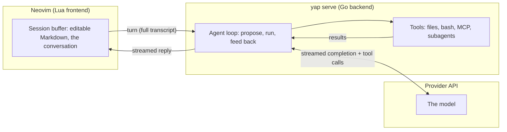

# yap

An LLM agent that lives in a Neovim buffer. You chat with it, and it can
edit files, run commands, search the web, and delegate to subagents. The
conversation is a plain Markdown buffer you edit like any other file.

Chat APIs are stateless: every request resends the whole conversation.
Delete a message and the next request won't include it. Edit a reply and the
model continues from your version. Branching, prefill and undo navigation are
just editing.

Inspired by pi and gptel.

## What you get

- Text objects and motions: edit a message, a thinking block or a tool region
  as text (`dam`, `]m`, `]u`, `]t`).
- Folding that collapses agent output or tool calls (`<leader>1/2/3`).
- Model replies stream into the session buffer and can be stopped mid-turn
  (`<C-c>`). Running tool output streams to a separate live tail (`<leader>l`).
- Approvals: destructive commands and secret paths pause for Run/Deny, and bash
  runs inside a bubblewrap sandbox on Linux.
- Context control: `:YapClear` swaps old tool output for audit-log pointers and
  `:YapCompact` folds the history into a summary.
- Prompt-cache breakpoints on the stable history, so a caching provider does
  not re-bill the whole prefix every turn.
- Templates and skills, injected into a conversation even while it runs.
- A file-backed scratch buffer that queues one follow-up and steers the current turn
  (`<leader>j`).
- Subagents, each a markdown file that behaves like any other session.
- Listed session buffers for normal buffer navigation; open and saved session
  trees through `vim.ui.select` (`+` for saved sessions).
- A `sessions` tool to list, search, and read other saved sessions, so a
  conversation can pull context from past ones without loading them whole.
- A winbar with the session title, model, token totals, cost and context use.
- Per-session model switching (`<leader>m`).
- `:YapEval` to discuss a selection in a new session, `:YapEval!` to replace it
  with the model's output in any buffer.
- Providers: native OpenAI, Anthropic, Gemini and DeepSeek, any
  OpenAI-compatible endpoint, or a ChatGPT plan login.
- A session-only language server (`yap lsp`) for document symbols, completion
  and structural diagnostics, scoped to managed sessions. nvim-cmp and
  blink.cmp can consume its completion through their generic LSP source
  (see `:help yap-lsp`).
- Fork a conversation into an independent session with `:YapFork`, then edit
  the transcript to change direction.
- A session jail runs Neovim inside bubblewrap, limiting the files and tools
  available to the whole session.
- Lazy MCP servers keep tool definitions out of context until the agent loads
  that server.

## Tools

The agent ships with a fixed set of built-in tools, plus any tools exposed by
configured MCP servers (named `mcp_<server>_<tool>`). It reads and edits
files, runs bash, fetches URLs, delegates to subagents in separate sessions,
and lists, searches, and reads other saved sessions. Web search, GitHub access
and browser control require separately configured MCP servers. Independent
read-only calls in one round run concurrently (up to four). See `:help yap-tools`.

A turn is an agent loop: the model proposes the next action, the backend
runs it, and the result feeds back until the model stops asking. The loop
lives in a Go backend (`yap serve`), one per session, driven from a Lua
frontend in Neovim:



## First run

Yap needs Neovim 0.11 or newer, plus these programs on `PATH`:

- `rg` (ripgrep) — the `search` and `glob` tools shell out to it.
- `bwrap` (bubblewrap) — the bash sandbox (Linux). Optional: without it the
  bash tool falls back to running unsandboxed.

1. Build the backend and put `yap` on Neovim's `PATH`:

   ```sh
   CGO_ENABLED=0 go build -o ~/.local/bin/yap ./agent
   ```
2. Configure a provider in `~/.config/yap/settings.json`:

   ```json
   {
     "providers": {
       "anthropic": {
         "base_url": "https://api.anthropic.com",
         "api_key_env": "ANTHROPIC_API_KEY"
       }
     },
     "mcp": {
       "exa": {
         "url": "https://mcp.exa.ai/mcp",
         "headers": { "x-api-key": "EXA_API_KEY" }
       }
     }
   }
   ```

   MCP servers expose their tools as `mcp_<server>_<tool>`. Each entry is a
   local stdio server (`command`, optional `args`/`cwd`) or an HTTP server
   (`url`); credentials are referenced through `env` (child var → Yap env var)
   or `headers` (header → Yap env var), never stored in the file. A header
   value may carry a literal scheme prefix, e.g. `"Bearer CENSYS_API_KEY"`
   sends `Authorization: Bearer <value>`. Set `"lazy": true` on a situational
   server to keep its tool definitions out of context: it exposes a single
   `mcp_<server>` loader tool that summarizes what the server offers, and the
   definitions enter context only when needed. Calling a listed tool directly
   works too: the call loads the server and then runs. Activation lasts for
   the session's backend, and changing the server's config re-arms it.

   Native providers (no `base_url` needed): `openai`, `anthropic`,
   `google`/`gemini`, `deepseek`. Any other name (`moonshot`, `openrouter`,
   z.ai, local servers) is OpenAI-compatible and requires a `base_url`.
   See `:help yap-configuration` for the full table.

   Export the key before starting Neovim: `export ANTHROPIC_API_KEY=<your-api-key>`.

   To bill a ChatGPT Plus/Pro plan instead of an API key, drop `api_key_env`
   and use `{"openai": {"auth": "chatgpt"}}`, then run `yap login chatgpt`
   once and approve access in the browser. Credentials land in
   `~/.config/yap/chatgpt.json` and refresh themselves. Login and token renewal
   are serialized across Yap processes for each auth method, so sessions can
   safely share rotating refresh tokens.
3. Install this repo as a Neovim plugin, or append
   `vim.opt.rtp:append("/path/to/yap")` to your config, then:

   ```lua
   require("harness").setup({ model_groups = { agent = "anthropic/claude-sonnet-5-5" } })
   ```
4. Run `:Yap`, type under `# @user`, and press `<C-s>`.

## Commands

| Command                      | Purpose                                                                                     |
| ---------------------------- | ------------------------------------------------------------------------------------------- |
| `:Yap`                       | Start a session.                                                                            |
| `:YapClear [keep]`           | Replace older tool output with audit-log references.                                        |
| `:YapCompact [instructions]` | Summarize with optional custom instructions, then optionally drop superseded history.       |
| `:YapEval[!] [instruction]`  | Discuss the selection in a new session. `!` replaces the selection with the model's output. |
| `:YapFork [name]`            | Copy the conversation to an independent buffer; edit it to branch.                          |

## Lua API

| Function                                 | Shortcut    | Purpose                                                         |
| ---------------------------------------- | ----------- | --------------------------------------------------------------- |
| `require("harness").send()`              | `<C-s>`     | send the transcript                                             |
| `require("harness").stop()`              | `<C-c>`     | stop the in-flight request                                      |
| `require("harness").live()`              | `<leader>l` | open the live tool tail                                         |
| `require("harness").guard()`             | `<leader>g` | open/close the guard board                                      |
| `require("harness").change_model(combo)` | `<leader>m` | set this session's provider/model                               |
| `require("harness").sessions()`          | `+`         | pick a saved session (current project)                            |
| `require("harness").sessions("all")`     | `g+`        | pick a saved session from any project (all projects)              |
| `require("harness").insert(name)`        | `<C-Enter>` | insert a template (and send it); merge a skill via insert(name) |

All shortcuts are configurable via `setup({ keymaps = ... })`; see `:help yap-keymaps`.
In a session buffer `<C-Enter>` calls `insert()`: it picks from the templates
and appends the chosen one as a message and sends it; skills are merged into
`# @system` with `insert(name)` instead. In the scratch buffer it calls
`insert(nil, { at_cursor = true })`, which drops the raw file at the cursor
without sending it.

Ordinary sessions are listed buffers backed by writable markdown files.
Rename `session.md` to set a permanent title (views then show that filename
instead of the auto-generated description); use your normal buffer navigation,
file explorer, and Neovim deletion commands. Subagent buffers stay unlisted and do
not count in the winbar overview.

`sessions()` is the session picker for the current project; `sessions("all")`
lists every saved session across all projects under the sessions root. Both
mark open rows with a live status icon and nest forks and subagents under
their parent in a box-drawing tree; the all-project picker suffixes each root
with its project so sessions from different worktrees are distinguishable.

## Rendering

yap writes plain markdown, so your renderer applies. Not all renderers are
written to handle 50k-line buffers, so there might be performance issues. Same
for other plugin that hook into Markdown files.

[touchup](https://git.boers.email/martijn/touchup.nvim) understands yap's
markers: it colors the `yap:thinking` / `tool` / `error` / `usage` labels and
draws each tool region as one block.

## Terminology

| Term             | Meaning                                                                      |
| ---------------- | ---------------------------------------------------------------------------- |
| session          | one conversation: Markdown file + audit log + notes.md scratch buffer        |
| session buffer   | the Neovim buffer editing a session                                          |
| message          | a `# @role` heading plus its body                                            |
| region           | a marker-delimited span: tool, thinking, error, or ui                        |
| tool region      | one tool call + its result                                                   |
| turn             | one completed send → one assistant reply                                     |
| send             | the action and in-flight request (`send()` / `<C-s>`)                        |
| prefill          | hand-writing an `# @assistant` message to continue from it                   |
| steer            | mid-turn injection of a `# @steer` body at a model boundary                  |
| approval         | the static rule that pauses a tool call for a Run/Deny answer                |
| agent definition | a `~/.config/yap/agents/<name>.md` file describing a subagent (not a “role”) |
| audit log        | the append-only `.jsonl` record                                              |
| tail view        | the `live()` tool-tail buffer                                                |

The full vocabulary is in `:help yap-glossary`.

## Notes

- yap uses a Nerd Font by default for winbar and picker glyphs. Set `nerd_font = false` in setup for plain Unicode.

## Session jail

On Linux, `programs.yap.jail` runs Neovim under bubblewrap with only the launch
directory, Yap config and configured paths mounted. Unlike the per-command
bash sandbox, it contains the editor, backend and other tools too. It does not
restrict network access by default; set `network = false` to disable egress.

```nix
programs.yap = {
  enable = true;
  envFile = config.age.secrets.api-keys.path;
  jail = {
    enable = true;
    name = "nvim-investigate";
    preExec = [ "/run/wrappers/bin/tunnel" ]; # optional, runs outside bwrap
    agentsFile = "${config.home.homeDirectory}/.yap/INVESTIGATE.md";
  };
};
```

Start the launcher from the case directory; it becomes `:pwd`. See the
`programs.yap.jail.*` options for credential forwarding, extra paths, and
session-directory configuration.

## Documentation

The full reference is in `:help yap` (`doc/yap.txt`). Before changing behavior,
anyone editing this repo, human or AI, should read `CONTRIBUTING.md`. It covers
the Lua \<-> Go wire protocol, the `R-...` design rules, and how to run the
tests (`tests/run.sh`). Update that file when your change affects those
details.
