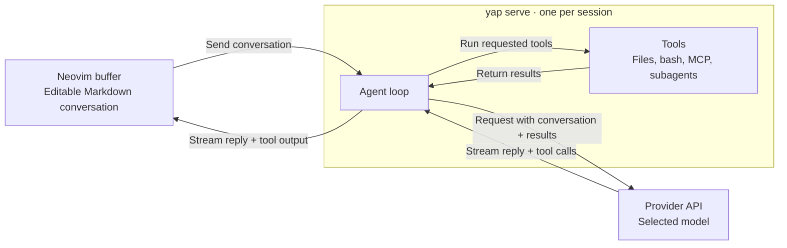

# yap

An LLM agent whose conversation is an editable Neovim buffer. Yap can edit
files, run commands, and delegate to subagents. You work on the conversation
with the same editor you use for the code.

The Markdown buffer is the source of truth. Delete a message and the next
send leaves it out. Edit a reply and the model continues from your version.
Use undo to revisit a direction, or `:YapFork` to try another in a separate
session.

Inspired by pi and gptel.

## A conversation is a file

Sessions are writable Markdown files and ordinary listed buffers. Switch
between them with your usual buffer navigation, arrange them in splits, and
save with `:write`. Rename a transcript with `:file` (`:f`) and write it to
give the session a permanent title instead of its generated description.

The editing details follow Neovim's conventions:

- Move between messages and tool regions with `]m`, `]u`, and `]t`; use text
  objects such as `dam` to edit whole messages.
- Fold replies, thinking, and tool output with `<leader>1/2/3`.
- Complete `@path` file references through LSP, alongside role headings and
  frontmatter. Built-in completion works by default; nvim-cmp and blink.cmp
  can use their LSP source.
- Use `:YapEval` to discuss a selection from any buffer, or `:YapEval!` to
  replace it with the model's output.

Open saved sessions with `+` for the current project or `g+` for all projects.
The picker shows live status and groups forks and subagents under their
parent. The agent can also search and read past sessions, bringing earlier
work into a conversation without loading every transcript.

`:YapDelete` permanently removes the current session and its files without
confirmation. Stop any running turn first.

## Change direction while it runs

Replies stream into the conversation. You can stop a turn with `<C-c>`,
inspect running tool output with `<leader>t`, or open the scratch buffer
with `<leader>j` to prepare what comes next:

- **Steer:** submit a `# @steer` message to redirect the current turn at its
  next model boundary.
- **Queue:** submit a `# @queue` message to send one follow-up when the current
  turn finishes successfully.
- **Switch models:** use `<leader>m` to change this session's model, including
  during a turn. The change takes effect at the next model boundary without
  interrupting the current model step or tool call.

Submit scratch messages with `<C-s>`. Merely typing does not send them, and
editing an armed steer or queue cancels its authorization until you submit
it again. Transcript edits affect subsequent turns; steering is how you
change the instructions for a turn already in progress.

The winbar keeps the current task, model, spend, and context usage in view.
It also summarizes other sessions by state, so you can work in one buffer
while noticing which agents are running or waiting for attention. Subagent
activity appears in the parent's winbar and live tool tail.

## Tools and context

Built-in tools read and edit files, run bash, fetch URLs, and delegate work
to subagents with their own session files. Independent read-only calls can
run concurrently. MCP servers add tools such as web search, GitHub access,
and browser control. Mark a server `lazy` to keep its tool definitions out
of context until the agent loads it.

Templates and skills supply reusable instructions, even during a running
session. `:YapClear` replaces older tool output with audit-log references;
`:YapCompact` summarizes history. Provider-supported prompt caching reuses
stable history, while transcript edits remain authoritative.

Destructive commands and secret paths pause for Run/Deny approval. On Linux,
bash runs inside bubblewrap when it is installed; **without bubblewrap, bash
runs unsandboxed**. The optional session jail contains the editor, backend,
and other tools too. See the jail setup below.

## First run

You need Neovim 0.11 or newer, Go to build the backend, and `rg` (ripgrep) on
`PATH`. Install `bwrap` (bubblewrap) on Linux for the bash sandbox.

1. From this repository, build the backend into a directory on Neovim's
   `PATH`:

   ```sh
   mkdir -p ~/.local/bin
   CGO_ENABLED=0 go build -o ~/.local/bin/yap ./agent
   ```
2. Configure a provider in `~/.config/yap/settings.json`:

   ```json
   {
     "providers": {
       "anthropic": {
         "api_key_env": "ANTHROPIC_API_KEY"
       }
     }
   }
   ```

   Set `ANTHROPIC_API_KEY` in your environment before starting Neovim.
3. Install this repository as a Neovim plugin, or append
   `vim.opt.rtp:append("/path/to/yap")` to your config, then configure a model:

   ```lua
   require("harness").setup({
     model_groups = { agent = "anthropic/claude-sonnet-5-5" },
   })
   ```
4. Run `:Yap`, type under the user heading, and press `<C-s>`.

Native providers include OpenAI, Anthropic, Gemini, and DeepSeek. Other
OpenAI-compatible endpoints work with a `base_url`. For a ChatGPT plan
login, configure `{"providers": {"openai": {"auth": "chatgpt"}}}`, run
`yap login chatgpt`, and choose an OpenAI model in setup.

MCP is optional. Configure local stdio or HTTP servers in `settings.json`;
credentials are referenced through environment variables rather than stored
in the file. See `:help yap-configuration` for provider and MCP setup.

## Controls to start with

| Key         | Action                                                                                 |
| ----------- | -------------------------------------------------------------------------------------- |
| `<C-s>`     | Send the conversation or submit a scratch message.                                     |
| `<C-c>`     | Stop the current turn.                                                                 |
| `<leader>j` | Open the scratch buffer to steer or queue. (You can just append # @user in the buffer) |
| `<leader>m` | Change this session's model.                                                           |
| `<leader>t` | Open the live tool tail.                                                               |
| `<leader>g` | Open or close the guard board.                                                         |
| `+` / `g+`  | Pick a saved session in this project / all projects.                                   |
| `<C-Enter>` | Pick and send a template in a session.                                                 |

In scratch, `<C-Enter>` inserts template text at the cursor without sending.
All shortcuts are configurable through `setup({ keymaps = ... })`.
See `:help yap-keymaps` for the full set.

## Display

Yap writes Markdown, so your renderer applies. Plugins that process entire
Markdown buffers can slow down on large transcripts.
[touchup](https://git.boers.email/martijn/touchup.nvim) understands Yap's
markers and renders each tool region as one block.

Tool and thinking regions are delimited by `<!-- yap:* -->` HTML comments,
which are display-only and never sent to the provider. In a plain buffer
they read as comment text, but
[render-markdown.nvim](https://github.com/MeanderingProgrammer/render-markdown.nvim)
conceals HTML comments by default, hiding the marker lines and the thinking
or tool-header text inside them. Keep them visible with:

```lua
require('render-markdown').setup({
    html = {
        comment = { conceal = false },
    },
})
```

A Nerd Font is used by default. Set `nerd_font = false` in setup for plain
Unicode glyphs.

<details>
<summary>Optional Linux session jail</summary>

`programs.yap.jail` runs Neovim under bubblewrap with only the launch
directory, Yap config, and configured paths mounted. Unlike the per-command
bash sandbox, it contains the editor, backend, and other tools too. It does
not restrict network access by default; set `network = false` to disable
egress.

```nix
programs.yap = {
  enable = true;
  envFile = config.age.secrets.api-keys.path;
  jail = {
    enable = true;
    name = "nvim-investigate";
    preExec = [ "/run/wrappers/bin/tunnel" ]; # optional, runs outside bwrap
    agentsFile = "${config.home.homeDirectory}/.yap/INVESTIGATE.md";
  };
};
```

Start the launcher from the case directory; it becomes `:pwd`. See the
`programs.yap.jail.*` options for credential forwarding, extra paths, and
session-directory configuration.

</details>

## How the agent works

Each session has a Lua frontend in Neovim and its own Go backend
(`yap serve`). On send, Yap reads the conversation from the buffer. The
backend calls the model, runs the tools it requests, and feeds their results
back until the model finishes. Replies stream into the same buffer.



## Reference and contributing

The full reference is in [`doc/yap.txt`](doc/yap.txt), available in Neovim as
`:help yap`. Start with `yap-configuration`, `yap-keymaps`, `yap-lsp`, or
`yap-tools` for the details behind the workflows above.

Before changing behavior, read [AGENTS.md](CONTRIBUTING.md) for business rules
like the wire protocol, design rules, and test instructions. Update it when a
change affects those contracts.

For contributing to the project read CONTRIBUTING.md
