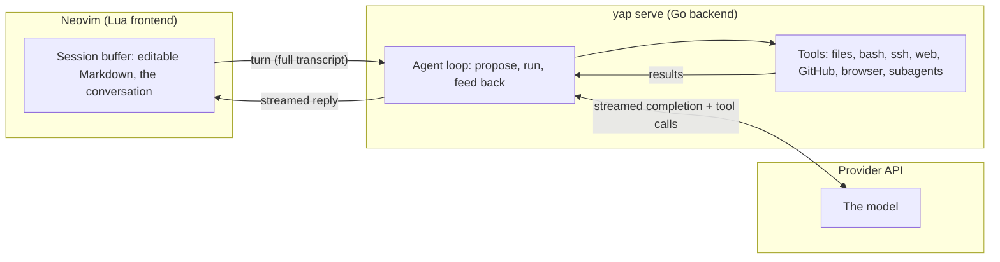

# yap

An LLM agent that lives in a Neovim buffer. You chat with it, and it can
edit files, run commands, search the web, and delegate to subagents. The
conversation is a plain Markdown buffer you edit like any other text or
file.

Chat APIs are stateless: every request sends the whole conversation again.
So the buffer is the conversation. Delete a message and the next request
won't include it. Edit a reply and the model continues from your version.
Branching, prefill, and undo navigation are just editing.

Inspired by pi and gptel.

## What you get

- Text objects for messages, thinking, and tool regions (`dit` clears a
  region, `dam` drops a message).
- `]`/`[` navigation between messages and regions (`]m`, `]u`, `]a`, `]t`).
- A winbar with session description, model, token totals, cost, and
  streaming status.
- Folding to collapse agent output or tool calls (`<leader>1/2/3`).
- Sessions as plain Markdown files you can resume, fork, and render.
- Subagents create new markdown files that are easy to track and manipulate.
- Templates and skills merged into the conversation (`insert()`).
- Options are presented with whatever picker you use (`vim.ui.select`).
- Drop images into the chat and the will get interpreted by the model.

## Tools

The agent ships with a fixed set of tools. It reads and edits files, runs
bash and ssh, searches the web, reads GitHub, drives a browser
with Playwright, and delegates to subagents in separate sessions. Independent
read-only calls in one round run concurrently (up to four). For slow bash,
fetch, or websearch work, `start_task` returns a turn-scoped handle so the agent
can continue independent work and later call `wait_tasks` for the result.\
See `:help yap-tools`.

A turn is an agent loop: the model proposes the next action, the backend
runs it, and the result feeds back until the model stops asking. The loop
lives in a Go backend (`yap serve`), one per session, driven from a Lua
frontend in Neovim:



## First run

Yap needs Neovim 0.11 or newer.

1. Build the backend and put `yap` on Neovim's `PATH`:

   ```sh
   CGO_ENABLED=0 go build -o ~/.local/bin/yap ./agent
   ```
2. Configure a provider in `~/.config/yap/settings.json`:

   ```json
   {
     "providers": {
       "anthropic": {
         "base_url": "https://api.anthropic.com",
         "api_key_env": "ANTHROPIC_API_KEY"
       }
     },
     "websearch": {
       "provider": "exa",
       "api_key_env": "EXA_API_KEY"
     }
   }
   ```

   The `websearch` tool has a pluggable backend (default `exa`); each backend
   is a self-registering Go package selected by name in the config.

   Native providers (no `base_url` needed): `openai`, `anthropic`,
   `google`/`gemini`, `deepseek`. Any other name (`moonshot`, `openrouter`,
   z.ai, local servers) is OpenAI-compatible and requires a `base_url`.
   See `:help yap-configuration` for the full table.

   Export the key before starting Neovim: `export ANTHROPIC_API_KEY=<your-api-key>`.
3. Install this repo as a Neovim plugin, or append
   `vim.opt.rtp:append("/path/to/yap")` to your config, then:

   ```lua
   require("harness").setup({ provider = "anthropic", model = "claude-sonnet-5-5" })
   ```
4. Run `:Yap`, type under `# @user`, and press `<C-s>`.

## Commands

| Command                     | Purpose                                                                                     |
| --------------------------- | ------------------------------------------------------------------------------------------- |
| `:Yap`                      | Start a session.                                                                            |
| `:YapClear [keep]`          | Replace older tool output with audit-log references.                                        |
| `:YapCompact`               | Summarize, then optionally drop superseded history.                                         |
| `:YapEval[!] [instruction]` | Discuss the selection in a new session. `!` replaces the selection with the model's output. |
| `:YapFork [name]`           | Copy the conversation to an independent buffer; edit it to branch.                          |

## Lua API

```lua
require("harness").send()                              -- <C-s>     send the transcript
require("harness").stop()                              -- <C-c>     stop the in-flight request
require("harness").live()                              -- <leader>l open the live tool tail
require("harness").guard()                             -- <leader>g open/close the guard board
require("harness").change_model(combo)                 -- <leader>m set this session's provider/model
require("harness").sessions(scope)                     --           resume a saved session ("cwd" | "all")
require("harness").instances()                         -- <leader>r pick another open session
require("harness").waiting()                           -- <leader>w pick a session awaiting your reply
require("harness").history()                           -- <leader>y pick a saved session with live status
require("harness").change_default_model()              -- <leader>M pick the default model for new sessions
require("harness").insert(name, { at_cursor = false }) -- <C-t>     insert template/ merge a skill
require("harness").insert_file({ from_insert = true }) -- <C-f>     pick a file and insert an @path reference
```

All shortcuts are configurable via `setup({ keymaps = ... })`; see `:help yap-keymaps`.

## Rendering

Markdown renders should work, but output or user input could break it.
[touchup](https://git.boers.email/martijn/touchup.nvim)
adds yap-aware rendering: it colors the `yap:thinking` / `tool` / `error` /
`usage` labels and draws each tool region as one region. Be aware that not
every Markdown renderer is built to handle 50k+ line files.

## Terminology

| Term             | Meaning                                                                      |
| ---------------- | ---------------------------------------------------------------------------- |
| session          | one conversation: Markdown file + audit log + scratch queue                  |
| session buffer   | the Neovim buffer editing a session                                          |
| message          | a `# @role` heading plus its body                                            |
| region           | a marker-delimited span: tool, thinking, error, or ui                        |
| tool region      | one tool call + its result                                                   |
| turn             | one completed send → one assistant reply                                     |
| send             | the action and in-flight request (`send()` / `<C-s>`)                        |
| prefill          | hand-writing an `# @assistant` message to continue from it                   |
| steer            | mid-turn injection of a `# @steer` body at a model boundary                  |
| approval         | the static rule that pauses a tool call for a Run/Deny answer                |
| agent definition | a `~/.config/yap/agents/<name>.md` file describing a subagent (not a “role”) |
| audit log        | the append-only `.jsonl` record                                              |
| tail view        | the `live()` tool-tail buffer                                                |

The full vocabulary is in `:help yap-glossary`.

## Notes

- yap uses a Nerd Font by default for winbar and picker glyphs. Set
  `nerd_font = false` in setup for plain Unicode.
- This is experimental. Editing inside a streaming reply can mix your text
  with the model's output, and streaming edits can interfere with undo.

## Documentation

The full reference is in `:help yap` (`doc/yap.txt`). The contributor-facing
contract — the Lua \<-> Go wire protocol and the numbered business rules —
lives in [`CONTRIBUTING.md`](CONTRIBUTING.md), together with how to run the
test suite (`tests/run.sh`). AI assistants (and any human
contributor) editing this repository MUST read `CONTRIBUTING.md` before
changing behaviour, and update it when they do.
