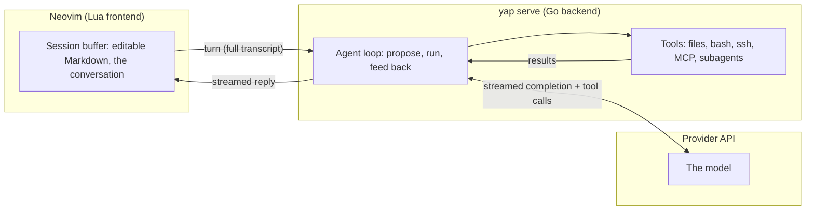

# yap

An LLM agent that lives in a Neovim buffer. You chat with it, and it can
edit files, run commands, search the web, and delegate to subagents. The
conversation is a plain Markdown buffer you edit like any other file.

Chat APIs are stateless: every request resends the whole conversation.
Delete a message and the next request won't include it. Edit a reply and the
model continues from your version. Branching, prefill and undo navigation are
just editing.

Inspired by pi and gptel.

## What you get

- Text objects and motions: edit a message, a thinking block or a tool region
  as text (`dam`, `]m`, `]u`, `]t`).
- Folding that collapses agent output or tool calls (`<leader>1/2/3`).
- Streaming replies, stoppable mid-turn (`<C-c>`).
- A live tool tail in its own buffer (`<leader>l`), so the conversation never
  takes the stream.
- Approvals: destructive commands and secret paths pause for Run/Deny, and bash
  runs inside a bubblewrap sandbox on Linux.
- Context control: `:YapClear` swaps old tool output for audit-log pointers and
  `:YapCompact` folds the history into a summary.
- Prompt-cache breakpoints on the stable history, so a caching provider does
  not re-bill the whole prefix every turn.
- Templates and skills, injected into a conversation even while it runs.
- A scratch buffer that queues one follow-up and steers the current turn
  (`<leader>s`).
- Subagents, each a markdown file that behaves like any other session.
- Pickers for open, waiting and saved sessions (`<leader>r`, `<leader>w`,
  `<leader>y`), all through `vim.ui.select`.
- A winbar with the session title, model, token totals, cost and context use,
  plus a rollup of your other sessions.
- Per-session model switching (`<leader>m`) and model groups, so a cheap model
  can title sessions and run `:YapEval`.
- `:YapEval` to discuss a selection in a new session, `:YapEval!` to replace it
  with the model's output in any buffer.
- Providers: native OpenAI, Anthropic, Gemini and DeepSeek, any
  OpenAI-compatible endpoint, or a ChatGPT plan login.
- An append-only audit log of every tool call, result and approval, per session.
- Images dropped into the buffer, sent to the model as image parts.

## Tools

The agent ships with a fixed set of built-in tools, plus any tools exposed by
configured MCP servers (named `mcp_<server>_<tool>`). It reads and edits
files, runs bash and ssh, searches the web, reads GitHub, drives a browser,
and delegates to subagents in separate sessions. Independent
read-only calls in one round run concurrently (up to four). For slow commands, pass `background: true` to bash; it returns a session-scoped
ID. Use `bash_output` to inspect its output or wait for its exit; it returns
only the log's tail, keeping the conversation small. Commands
continue across turns and stop when the session backend exits.
See `:help yap-tools`.

A turn is an agent loop: the model proposes the next action, the backend
runs it, and the result feeds back until the model stops asking. The loop
lives in a Go backend (`yap serve`), one per session, driven from a Lua
frontend in Neovim:



## First run

Yap needs Neovim 0.11 or newer, plus these programs on `PATH`:

- `rg` (ripgrep) — the `search` and `glob` tools shell out to it.
- `curl` — the `curl` command.
- `bwrap` (bubblewrap) — the bash sandbox (Linux). Optional: without it the
  bash tool falls back to running unsandboxed.

1. Build the backend and put `yap` on Neovim's `PATH`:

   ```sh
   CGO_ENABLED=0 go build -o ~/.local/bin/yap ./agent
   ```
2. Configure a provider in `~/.config/yap/settings.json`:

   ```json
   {
     "providers": {
       "anthropic": {
         "base_url": "https://api.anthropic.com",
         "api_key_env": "ANTHROPIC_API_KEY"
       }
     },
     "mcp": {
       "exa": {
         "url": "https://mcp.exa.ai/mcp",
         "headers": { "x-api-key": "EXA_API_KEY" }
       }
     }
   }
   ```

   MCP servers expose their tools as `mcp_<server>_<tool>`. Each entry is a
   local stdio server (`command`, optional `args`/`cwd`) or an HTTP server
   (`url`); credentials are referenced through `env` (child var → Yap env var)
   or `headers` (header → Yap env var), never stored in the file. A header
   value may carry a literal scheme prefix, e.g. `"Bearer CENSYS_API_KEY"`
   sends `Authorization: Bearer <value>`. Set `"lazy": true` on a situational
   server so its tool definitions stay out of context until the model asks
   for them: it exposes a single `mcp_<server>` loader tool, and calling that
   pulls the real tools in for the rest of the turn.

   Native providers (no `base_url` needed): `openai`, `anthropic`,
   `google`/`gemini`, `deepseek`. Any other name (`moonshot`, `openrouter`,
   z.ai, local servers) is OpenAI-compatible and requires a `base_url`.
   See `:help yap-configuration` for the full table.

   Export the key before starting Neovim: `export ANTHROPIC_API_KEY=<your-api-key>`.

   To bill a ChatGPT Plus/Pro plan instead of an API key, drop `api_key_env`
   and use `{"openai": {"auth": "chatgpt"}}`, then run `yap login chatgpt`
   once and approve access in the browser. Credentials land in
   `~/.config/yap/chatgpt.json` and refresh themselves. Login and token renewal
   are serialized across Yap processes for each auth method, so sessions can
   safely share rotating refresh tokens.
3. Install this repo as a Neovim plugin, or append
   `vim.opt.rtp:append("/path/to/yap")` to your config, then:

   ```lua
   require("harness").setup({ model_groups = { agent = "anthropic/claude-sonnet-5-5" } })
   ```
4. Run `:Yap`, type under `# @user`, and press `<C-s>`.

## Commands

| Command                      | Purpose                                                                                     |
| ---------------------------- | ------------------------------------------------------------------------------------------- |
| `:Yap`                       | Start a session.                                                                            |
| `:YapClear [keep]`           | Replace older tool output with audit-log references.                                        |
| `:YapCompact [instructions]` | Summarize with optional custom instructions, then optionally drop superseded history.       |
| `:YapEval[!] [instruction]`  | Discuss the selection in a new session. `!` replaces the selection with the model's output. |
| `:YapFork [name]`            | Copy the conversation to an independent buffer; edit it to branch.                          |

## Lua API

| Function                                                 | Shortcut    | Purpose                                     |
| -------------------------------------------------------- | ----------- | ------------------------------------------- |
| `require("harness").send()`                              | `<C-s>`     | send the transcript                         |
| `require("harness").stop()`                              | `<C-c>`     | stop the in-flight request                  |
| `require("harness").live()`                              | `<leader>l` | open the live tool tail                     |
| `require("harness").guard()`                             | `<leader>g` | open/close the guard board                  |
| `require("harness").change_model(combo)`                 | `<leader>m` | set this session's provider/model           |
| `require("harness").sessions(scope)`                     | `<leader>y` | resume a saved session (`cwd` \| `all`)     |
| `require("harness").instances()`                         | `<leader>r` | pick another open session                   |
| `require("harness").waiting()`                           | `<leader>w` | pick a session awaiting your reply          |
| `require("harness").insert(name, { at_cursor = false })` | `<C-t>`     | insert template / merge a skill             |
| `require("harness").insert_file({ from_insert = true })` | `<C-f>`     | pick a file and insert an `@path` reference |

All shortcuts are configurable via `setup({ keymaps = ... })`; see `:help yap-keymaps`.

## Session jail

The bash sandbox confines one process. The editor, the backend and every other
tool still run with your full rights. To contain a whole session, the flake's
home-manager module starts Neovim inside bubblewrap, with only the launch
directory, the nix toolchain and yap's config mounted. Other projects, notes
and `~/.ssh` do not exist in there, so a prompt-injected model has nothing to
read.

```nix
programs.yap = {
  enable = true;
  envFile = config.age.secrets.api-keys.path;
  jail = {
    enable = true;
    name = "nvim-investigate";
    preExec = [ "/run/wrappers/bin/tunnel" ]; # optional, runs outside bwrap
    agentsFile = "${config.home.homeDirectory}/.yap/INVESTIGATE.md";
  };
};
```

`cd` into a case directory before starting the launcher. That directory becomes
`:pwd`, and sessions land in `.yap-sessions` beside it. Add that to your
gitignore.

The module installs a `yap` backend launcher that sources `envFile` at runtime.
Pass `${lib.getExe config.programs.yap.backendPackage}` as `bin` to
`require('harness').setup()` in your Neovim config. Set harness options such
as `model_groups`, `agents_file`, `skills_dir`, and `sessions_dir` there, not
in `programs.yap`. The jail sources the same file outside bubblewrap; set
`jail.envFile` only if it needs a different one. The jail forwards credential
variables named by providers and MCP servers (`env`/`headers` mappings).

If `setup()` overrides the default `sessions_dir` or `agents_file`, set
`jail.sessionsDir` or `jail.agentsTargetFile` to the matching path. Bind any
non-default skills, agents and templates directories with
`jail.extraReadOnlyPaths`.

`preExec` wraps the jail from outside. bubblewrap sets `NoNewPrivs`, so a setuid
network namespace wrapper such as a VPN has to run before it, never inside.
Only the configured credential variables reach the jail.

Linux only. The jail bounds the filesystem, not the network, because the host
network namespace is shared. Pair it with `preExec` when traffic must leave
from a VPN, or set `network = false` to drop egress and accept that model
providers stop answering. `programs.yap.jail.*` documents the remaining
options.

## Rendering

yap writes plain markdown, so your renderer applies. Not all renderers are
written to handle 50k-line buffers, so there might be performance issues. Same
for other plugin that hook into Markdown files. 

[touchup](https://git.boers.email/martijn/touchup.nvim) understands yap's
markers: it colors the `yap:thinking` / `tool` / `error` / `usage` labels and
draws each tool region as one block.

## Terminology

| Term             | Meaning                                                                      |
| ---------------- | ---------------------------------------------------------------------------- |
| session          | one conversation: Markdown file + audit log + scratch queue                  |
| session buffer   | the Neovim buffer editing a session                                          |
| message          | a `# @role` heading plus its body                                            |
| region           | a marker-delimited span: tool, thinking, error, or ui                        |
| tool region      | one tool call + its result                                                   |
| turn             | one completed send → one assistant reply                                     |
| send             | the action and in-flight request (`send()` / `<C-s>`)                        |
| prefill          | hand-writing an `# @assistant` message to continue from it                   |
| steer            | mid-turn injection of a `# @steer` body at a model boundary                  |
| approval         | the static rule that pauses a tool call for a Run/Deny answer                |
| agent definition | a `~/.config/yap/agents/<name>.md` file describing a subagent (not a “role”) |
| audit log        | the append-only `.jsonl` record                                              |
| tail view        | the `live()` tool-tail buffer                                                |

The full vocabulary is in `:help yap-glossary`.

## Notes

- yap uses a Nerd Font by default for winbar and picker glyphs. Set
  `nerd_font = false` in setup for plain Unicode.
- This is experimental. Editing inside a streaming reply can mix your text
  with the model's output, and streaming edits can interfere with undo.

## Documentation

The full reference is in `:help yap` (`doc/yap.txt`). Before changing behavior,
anyone editing this repo, human or AI, should read `CONTRIBUTING.md`. It covers
the Lua \<-> Go wire protocol, the `R-...` design rules, and how to run the
tests (`tests/run.sh`). Update that file when your change affects those
details.
